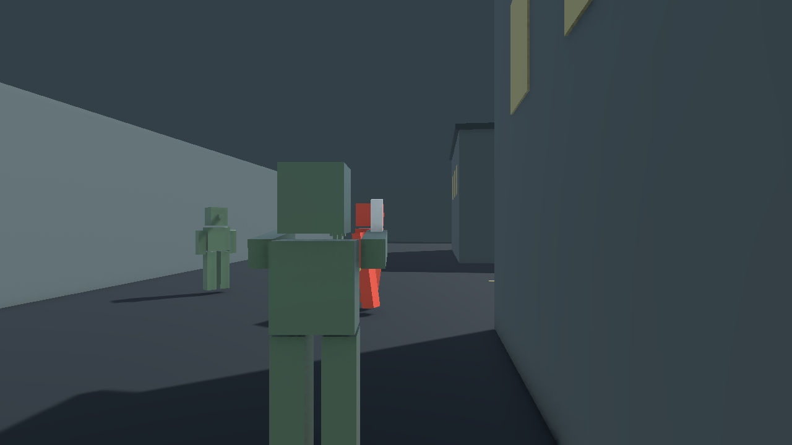

# DEAD CROWD 커스텀 가이드

2026-11-02. 기본 설정은 상세 기획서 v1.0의 시작값입니다. Inspector의 대부분 설정을 코드 수정 없이 바꿀 수 있습니다. 밸런스 확정값이나 모든 에셋에 대한 자동 리타겟을 뜻하지 않습니다.

## 먼저 선택할 곳

`DEAD CROWD > Content > Select Active Content Catalog`를 실행합니다. 기본 파일은 `Assets/Main/06_Content/Resources/Crowd/ContentCatalog.asset`입니다.

| Catalog 참조 | 역할 | 기본 자산 |
| --- | --- | --- |
| Game Settings | 체력·이동·전투·노출·NPC·카메라·개체 수 | 같은 폴더의 GameSettings.asset |
| Map | 경기 범위·시작 조합·NPC 배치 | Assets/Main/07_Polish/CityLayout.asset (기본 선택 변형) |
| Presentation | 공통 외형·Animator 연결·소리·색·피격 효과 | Assets/Main/07_Polish/RefinedPresentation.asset (기본 선택 변형) |

변형을 만들려면 원하는 설정 자산을 복제하고 Catalog의 참조를 바꿉니다. Catalog 자체의 고정 Resources 경로는 유지합니다. 복제한 자산은 일반 폴더에 두어도 참조를 통해 빌드에 포함됩니다. `Create > DEAD CROWD` 메뉴로 각 설정 자산을 새로 만들 수도 있습니다. 새 Map Profile은 2인/4인 시작 조합을 채운 뒤 사용합니다.

`Create Missing Default Assets`는 기존 설정 값을 초기화하지 않습니다. 새 기본 캐릭터를 생성할 때만 근접 무기/피격 레이어를 연결합니다. 이미 편집한 기본 Prefab에서 무기를 제거해도 일반 생성/빌드 메뉴가 다시 채우지 않습니다.

## 수치·AI 조정

`Select Game Settings`로 현재 Catalog의 설정을 선택합니다. Inspector의 Movement, Melee, Pistol, Exposure, NPC, Camera 그룹을 편집합니다.

- MAX_HP, ROUND_SECONDS: 공통 체력과 경기 시간.
- BACK_HALF_ANGLE: 후방 반각, 현재 기본 80도. BACKSTAB_WINDUP_GRACE를 켜면 공격 시작에 후방이던 같은 대상의 판정을 선딜레이 동안 유지합니다. 자세한 기준은 [v8 변경](DEAD_CROWD_후방_판정_v8.md)을 따릅니다.
- WALK/SPRINT/AIM/MELEE_SPEED, TURN_SPEED: 이동과 회전 상한. 플레이어·NPC의 기본 보행은 같은 WALK_SPEED를 사용합니다.
- MELEE_WINDUP/CYCLE, GUN_INTERVAL, RELOAD_SECONDS: 타격 선딜·행동 잠금. HALF_ANGLE은 전체 각도가 아닌 반각입니다.
- EXP_*: 행동별 노출과 감소. 노출 최대치/노출 상태의 의미는 현재 규칙에서 100 기준입니다.
- EXP_HIDDEN_DELAY: 은신 유지 중 마지막 위험 행동 이후 감소 대기, 기본 4초. EXP_DELAY: 한번 노출된 뒤 0에 도달할 때까지의 감소 대기, 기존 2초. EXP_DECAY: 두 상태 공통 초당 감소량, 기존 15. 자세한 기준은 [v9 변경](DEAD_CROWD_노출_회복_v9.md)을 따릅니다.
- AI_* / SIGHT_*: 시야·추격·공격·배회 반경·대기·수색·진행 실패 제한.
- DUEL_NPCS/FFA_NPCS: 모드별 전체 NPC 수. 기본값은 20/30입니다.
- NOISE_*: AI가 조사하는 게임 규칙상의 소음 반경. 실제 AudioSource 감쇠 범위와는 별도입니다.
- CAMERA_*: 카메라 위치·조준 거리·FOV·벽 검사 반경. 호스트 사격 시점 계산도 같은 값을 사용합니다.

접속할 때 설정과 맵을 복제해 세션용 값으로 고정합니다. 자산을 바꾸면 방을 닫고 다시 생성해야 다음 세션에 반영됩니다. 여러 참가자가 테스트할 때는 저장 후 동일한 새 빌드를 전달합니다. 규칙·맵 설정과 Scene 충돌 구성의 서명이 다르면 입장을 거절합니다. 다른 프로토콜 버전의 방은 별도 매칭 범위여서 방을 찾지 못할 수 있습니다.

## 캐릭터·애니메이션 교체

기본 선택 변형은 `Assets/Main/07_Polish/CommonCitizen.prefab`입니다. 피부·상의·바지·신발과 권총/봉을 구분한 공통 사람형 모델이며, 원래 `Assets/Main/06_Content/CommonCharacter.prefab`도 유지합니다. 대기·보행·질주·조준 이동·근접·발사·재장전·사망, 별도 피격 레이어를 가진 Animator Controller와 AnimationClip이 저장돼 있습니다. 플레이어와 NPC는 같은 Prefab을 사용합니다.

교체 순서:

1. 기본 Prefab을 복제하거나 새 시각용 Prefab에 CrowdActorPresentation을 붙입니다.
2. Animator와 Body Renderers 배열을 연결합니다. SkinnedMeshRenderer도 Renderer 참조로 넣을 수 있습니다.
3. 권총 오브젝트(Weapon Obj)와 근접 오브젝트(Melee Weapon Obj)를 연결합니다. 각각 선택 사항입니다.
4. 모델의 발 기준점을 로컬 원점에 맞추고 +Z를 앞쪽으로 배치합니다. 기본 충돌체는 높이 1.8m, 반지름 0.3m입니다. 시각용 Prefab에는 Collider·NetworkObject·독립 이동 스크립트를 넣지 않습니다. Collider/NetworkObject 혼입이나 필수 참조 누락은 접속 전에 구성 오류로 안내합니다.
5. Presentation Profile의 Common Visual Prefab을 교체합니다. Root Motion은 런타임에서 꺼집니다.

기본 Animator 계약:

| 종류 | 기본 이름 | 의미 |
| --- | --- | --- |
| Float | Speed | 렌더 프레임에서 관측한 이동 속도 |
| Bool | Aim / Dead | 조준·사망 |
| Int | Action | 0 일반, 1 근접, 2 발사, 3 재장전 |
| Trigger | Hit | 피격 반응. Hit Parameter를 비우면 트리거를 보내지 않음 |
| 기본 레이어 State | Melee / Shot / Reload | 호스트 행동 타이머로 진행률을 맞출 상태 |

이름이 다른 Animator는 Presentation Profile의 파라미터·State 이름을 변경하면 됩니다. Humanoid 리타겟은 사용하는 모델/Avatar에 맞춰 Unity에서 구성합니다. 기본 Controller를 강제로 새 모델에 적용할 필요는 없습니다.

Melee Clip Hit Phase는 클립에서 무기가 실제로 닿는 위치의 정규화 시간(0~1)입니다. 기본값은 0.3/0.85입니다. 근접 선딜·주기를 바꾸어도 이 프레임을 호스트 타격 Tick에 맞춰 샘플링합니다. 행동이 지속되는 동안 기본 레이어의 해당 State를 타이머로 구동하므로, 상체 마스크/추가 레이어는 별도로 구성할 수 있습니다. **Animation Event로 피해를 적용하지 마십시오.** 실제 피해와 동시 결산은 호스트 코드가 처리합니다.

## 소리·효과 교체

Presentation Profile에서 Footstep/Melee/Shot/Reload/Hit/Death/Local Warning AudioClip을 바꿉니다. 기본 효과음은 직접 생성한 짧은 합성 WAV이며 최종 음향 디자인은 교체할 수 있습니다. 별도 다운로드나 라이선스 의존성은 없습니다.

- Volume, Audio Range: 월드 효과음 크기·3D 감쇠 범위.
- Footstep Distance: 이동 거리당 발소리 간격. 빠르게 이동하면 간격이 짧아집니다.
- Use Material Colors: 켜면 각 머티리얼의 피부·옷 색을 유지합니다. 새 변형은 이 옵션을 사용하며 07_Polish의 머티리얼을 편집합니다. 끄면 Body Color로 공통 색을 지정합니다.
- Body Color / Hit Color / Hit Flash Seconds: 공통 몸 색과 피격 플래시. 머티리얼은 URP Lit의 _BaseColor를 사용합니다. 다른 셰이더는 이 프로퍼티 지원 여부를 확인합니다.
- Play Local Warnings: 본인의 노출 상태 진입·빈 탄창 경고. AI 소음 사건을 만들지 않습니다.
- 발사 선은 기존 네트워크 Actor Prefab의 LineRenderer와 ShotTrail 머티리얼을 편집합니다.

사운드는 권한 Sequence 변화에 따라 한 번 재생합니다. 평상시 NPC 전용 소리·식별 색·머리 위 슬롯 표시는 추가하지 않습니다.

## 맵 수정

`DeadCrowd.unity`의 `City Blockout` 아래 건물·바닥·경계를 편집합니다. 현재 기본 맵은 약 40m 시가지 블록아웃이며 최종 환경 아트 교체가 가능합니다.

- `Map Editing Tools`를 선택하고 Gizmos를 켜면 경기 범위, 시작점, 시작 주변 NPC 반경을 봅니다.
- Map Profile의 Start Sets는 2개 또는 4개 위치의 승인 조합입니다. 코드가 조합 하나를 고른 뒤 그 안의 참가자 배정을 섞습니다.
- 시작점은 NavMesh 위이고 벽과 겹치지 않아야 하며, 같은 조합의 시작점끼리 직접 시야가 없어야 합니다. 모든 시작점 사이에 완전한 NavMesh 경로가 있어야 합니다. 후보가 없으면 전투를 시작하지 않고 방을 정리합니다.
- Bounds Min/Max, Nearby Npcs Per Player, Npc Start Radius, Body Separation으로 분포를 조정합니다. 전체 NPC 수는 Game Settings에서 바꿉니다.
- Collider와 보이는 형태가 맞도록 편집하고 World 루트의 NavMeshSurface 수집 범위를 유지합니다. `DEAD CROWD > Content > Rebuild Main Scene NavMesh`를 실행해 저장합니다. 본 개발 전용 MainCityNavMesh.asset을 생성하며 프로토타입 NavMesh를 덮어쓰지 않습니다.
- 벽·충돌 변경은 경로와 시작 시야를 다시 확인합니다. Scene 충돌 구성도 서명에 포함됩니다. 읽을 수 없는 외부 MeshCollider의 내부 정점 변경이나 네트워크 Actor의 충돌체 변경은 Map Version도 반드시 올리고 동일 빌드로 테스트합니다.

기본 네트워크 본체는 `Assets/Main/03_Prefab/Prototype/CrowdActor.prefab`입니다. 이름은 이행 호환성을 위해 유지했습니다. 캐릭터 외형 교체는 Presentation Profile을 사용하고, 공통 충돌 크기/네트워크 본체를 바꾸는 경우 NavMesh agent·Body Separation·카메라·공격 거리를 함께 재검토합니다.

## 코드에서 수정할 곳과 검증

- CrowdGameSettings / CrowdMapProfile / CrowdPresentationProfile: Inspector 데이터.
- CrowdContent: 접속 시 스냅샷과 호환성 서명.
- CrowdMatch.Player.cs: 예측과 권한이 공유하는 플레이어 행동/이동.
- CrowdMatch.Combat.cs: 명중 검사·공격 ID 중복 방지.
- CrowdMatch.Npc.cs: 호스트 전용 NPC 시야·기억·배회·추격·조사.
- 기존 CrowdMatch.cs: 세션·로딩·배치·Tick 순서·동시 피해/결과 결산.
- CrowdActorPresentation: 시각·오디오 어댑터. 전투 판정을 하지 않습니다.

저장 후 `DEAD CROWD > Development > Build Windows`로 개발 빌드를 만듭니다. `Tools/Verify-SessionLifecycle.ps1`과 `Tools/Verify-Movement.ps1 -SimulatedDelay`는 기본 설정의 회귀 검사이며, 체력/탄약/시간을 의도적으로 바꾼 커스텀 프로필에서는 기대값도 검토해야 합니다. 실제 두 PC, 장시간 NPC 밀도, 수동 조작감·음향과 성능 확인은 별도입니다.

## 이전 v5 기본 콘텐츠 참고 화면

이 이미지는 이전 v5의 Camera 렌더 프레임입니다. 현재 v6의 CommonCitizen과 City Details는 별도 새 변형이며, QA 제외 요청에 따라 이번에는 실행 화면을 촬영하지 않았습니다.

## v6 구현 보완과 새 변형

- 게임 규칙의 기본 수치와 NPC 수는 유지했습니다. 실제 플레이 자료 없이 승률·밀도 수치를 새 밸런스로 확정하지 않았습니다.
- 추격 목표를 갱신해도 막힘 타이머를 초기화하지 않습니다. 움직이는 목표를 추격할 때는 NPC 실제 변위로, 고정된 배회/조사 목표에서는 남은 경로 길이 감소로 진행을 판단합니다. 막힌 추격은 현재 위치에서 수색하며 AI_WAIT_MIN 동안 재추격을 유예합니다. 공격 중 강제 정지는 막힘 시간에 포함하지 않습니다.
- 근접 전체 주기는 선딜보다 커야 합니다. 둘이 같은 Tick으로 반올림되면 타격 Tick 결산까지 행동을 유지합니다.
- 시작점 중복·비유한 맵 수치·잘못된 양수 시간 설정을 거절합니다. NPC 후보는 기준점에서 완전한 NavMesh 경로로 연결된 위치만 사용합니다.
- 설정/맵/표현 Inspector에 오류 안내가 표시됩니다. `DEAD CROWD > Content > Validate Active Content`로 Animator 파라미터 타입과 기본 레이어 State도 검사할 수 있습니다. 실행 중 잘못된 표현 연결은 로드 실패로 처리합니다.
- CommonCitizen, RefinedPresentation, CityLayout, 머티리얼, 11개 Animation Override Clip, 6개 용도별 합성 효과음은 `Assets/Main/07_Polish`에 저장됩니다. 기존 06_Content 자산을 선택해 이전 표현으로 돌아갈 수도 있습니다.
- 새 시가지 디테일은 Scene의 `City Blockout/City Details` 아래에 있습니다. 건물·도로·광장 머티리얼을 구분하고 간판·가로등을 추가했으며 본 개발 NavMesh를 다시 베이크했습니다. 변경 후 경로/시야가 적절한지는 플레이 QA가 필요합니다.
- 프로토콜은 `dead-crowd-development-6`입니다. 참가자 모두 새 빌드를 사용합니다.

이번 변경은 컴파일·자산 생성·정적 연결 검사·Windows 빌드까지 확인했습니다. 게임 실행, 네트워크 QA, 소리 청취와 밸런스/성능 측정은 요청에 따라 하지 않았습니다. Animator 상태 검사 API는 [Unity Animator.HasState](https://docs.unity3d.com/jp/current/ScriptReference/Animator.HasState.html)를 참고했습니다.

## v7 선공/이탈 튜닝

기본 질주 속도는 6m/s이며, EXPOSED_SPRINT_ALLOWS_RECOVERY가 켜져 있으면 이미 노출된 동안 질주가 회복을 방해하지 않습니다. 비노출 질주 비용과 재공격 비용은 유지합니다. 자세한 우선 규칙과 동선은 [v7 변경 기록](DEAD_CROWD_밸런스_변경_v7.md)을 참고합니다. 차폐물은 City Blockout/Escape Routes에서 편집하고 NavMesh를 다시 저장합니다. 참가자 모두 protocol v7의 새 빌드가 필요합니다.
